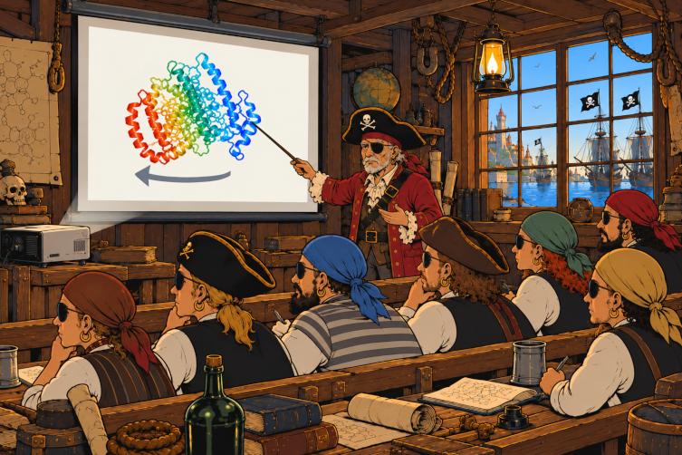
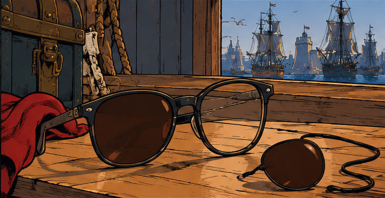
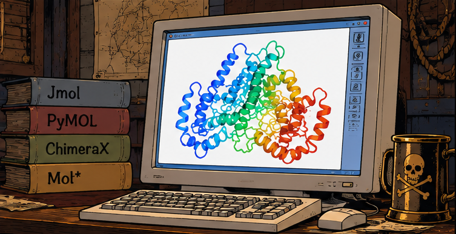

## Idea


**Pirate Vision** is an emerging vintage technology that exploits [the Pulfrich effect](https://en.wikipedia.org/wiki/Pulfrich_effect) for viewing molecular structures (e.g. protein structures) in 3D.

Basic idea - open a molecular structure in some viewer, set the animation to spin, cover one eye with a filter (e.g. put on sunglasses with one lence removed), and experience the 3D perception.

Spinning direction matters: if your left eye is covered - spin left, if your right eye is covered - spin right.

It is called **Pirate Vision** because when one of your eyes is covered, you look like a pirate.

This page describes how to setup and use **Pirate Vision** with some popular molecular viewers.

Just break some sunglasses and try it!

It also works very well in a classsrom setting.



## Equipment

Sunglasses that cover only a single eye. For example, ordinary sunglasses with one lense removed. Or a tintend monocle.



Molecular viewer software (not necessarily pirated, can be free or even legally purchased) able to do spinning animation.



Both eyes (apologies to real pirates with just a single eye).


## Recipes for molecular viewers

This section explains how to use **Pirate Vision** with the following popular molecular viewers:

* JMol
* PyMol
* ChimeraX
* Mol\*

### JMol

JMol is compatible with **Pirate Vision** out of the box - it has the `spin` command that can be used.

Just load or fetch a structure, for example

```
load =2zsk
```

Setup the view in any way you wish (it also can be adjusted an any time later). It is recommended (but not super necessary) to set the background to white:

```
background white
```

Then, run the `spin` command, prividing speed (angles per second) as the only parameter.

Pirates with a filter on the **left** eye should run `spin` with negative speed, for example:

```
spin y -90
```

Pirates with a filter on the **right** eye should run `spin` with positive speed, for example:

```
spin y 90
```

To stop, run:

```
spin off
```

### Pymol

First, let's define the `pirate` command.

Paste the following command to the Pymol command prompt:

```
python
from pymol import cmd, util

def pirate(speed=90):
    speed = float(speed)

    if speed == 0:
        cmd.mstop()
        return

    fps = cmd.get_setting_float('movie_fps') or 30
    frames = max(2, round(360 * fps / abs(speed)))

    cmd.mstop()
    cmd.mset(f"1 x{frames}")
    util.mroll(1, frames, 1, '-y' if speed > 0 else 'y')
    cmd.set('movie_loop', 1)
    cmd.mplay()

cmd.extend('pirate', pirate)
python end
```

Alternatively, download the [`pymol_pirate_vision.py`](scripts/pymol_pirate_vision.py) script and run it:

```
run pymol_pirate_vision.py
```

Then load or fetch a structure, for example:

```
fetch 2zsk
```

Setup the view in any way you wish (it also can be adjusted an any time later). It is recommended (but not super necessary) to set the background to white:

```
bg_color white
```

Then, run the `pirate` command, prividing speed (angles per second) as the only parameter.

Pirates with a filter on the **left** eye should run `pirate` with positive speed, for example:

```
pirate 90
```

Pirates with a filter on the **right** eye should run `pirate` with negative speed, for example:

```
pirate -90
```

To stop, run `pirate` with zero speed:

```
pirate 0
```

### ChimeraX

First, let's define the `pirate` command, using the following script:

```
from chimerax.core.commands import CmdDesc, FloatArg, register, run
from chimerax.core.errors import UserError

def pirate(session, speed=90):
    try:
        run(session, "perframe stop")
    except UserError as e:
        if "No per-frame command active" not in str(e):
            raise

    if speed != 0:
        run(session, f'perframe "turn y {-speed / 60}"')

register(
    'pirate',
    CmdDesc(
        optional=[('speed', FloatArg)],
        synopsis='Spin the molecule for Pirate Vision'
    ),
    pirate,
    logger=session.logger
)
```

Download this script as [`chimerax_pirate_vision.py`](scripts/chimerax_pirate_vision.py) and run it:

```
open chimerax_pirate_vision.py
```

Then load or fetch a structure, for example:

```
open 2zsk.cif
```

Setup the view in any way you wish (it also can be adjusted an any time later). It is recommended (but not super necessary) to set the background to white:

```
set bgColor white
```

Then, run the `pirate` command, prividing speed (angles per second) as the only parameter.

Pirates with a filter on the **left** eye should run `pirate` with positive speed, for example:

```
pirate 90
```

Pirates with a filter on the **right** eye should run `pirate` with negative speed, for example:

```
pirate -90
```

To stop, run `pirate` with zero speed:

```
pirate 0
```

### Mol\*

Mol\* is compatible with **Pirate Vision** out of the box - just not through scripting, but from GUI,

Open a molecular structure in Mol*, for example, [PDB 2ZSK](https://www.rcsb.org/3d-view/2ZSK).

Open the *"Settings/Control Info"* panel (the settings icon on the right border of the 3D scene, near the upper-right corner).

Under *"Animate"*, select *"Spin"*.

Using the config button that appears near near the selected *Spin* option, configure the spinning parameters:

* Set *"Axis"* to (`[0, 1, 0]`) for pirates with a filter on the **right** eye, or to (`[0, -1, 0]`) pirates with a filter on the **right** eye.
* Adjust *"Speed"* to your preference using the interactive slider. Note that setting negative speed reverses the spinning direction.

The background can also be changed to white in the same settings panel.

To stop spinning, change *"Animate"* to *"Off"*.

Alternatively, press `i` to toggle spinning on or off - but the axis and the speed are preset when spin is toggled with `i`.

